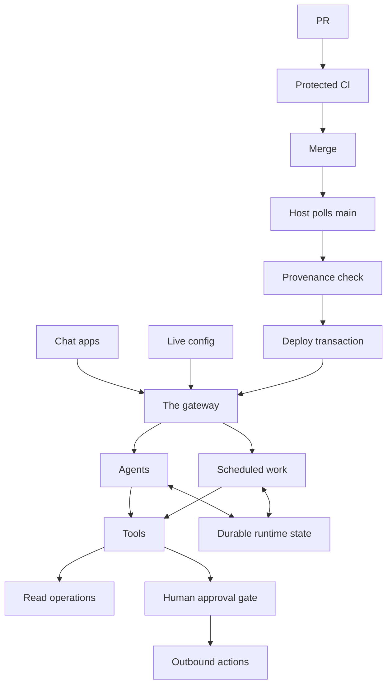

# Running a personal AI agent in production: a case study

## TL;DR

A single developer runs a personal AI-agent gateway on a home server.
The gateway connects chat apps, an open-source agent framework, scheduled
work, and tools that can affect the outside world.
The hard part is keeping those effects bounded while the system changes.

This case study focuses on five engineering decisions:

- Assign authority separately to source code, durable state, and live config.
- Update owner-editable code only when it still matches the last deployed blob.
- Pin dependency patches to known versions and detect byte or marker drift.
- Bind outbound actions to explicit human approval at the execution boundary.
- Spend review effort according to risk and reuse valid verification receipts.
The result is an operational pattern for one developer, with explicit
boundaries around automation, recovery, and human judgment.
It is a case study of engineering choices, not an availability claim.

This public account is distilled from private code, tests, history, and runbooks.
Names, topology details, destinations, and operational identifiers are omitted.
Examples use invented strings and are written from scratch.
They illustrate contracts rather than reproduce a deployable gateway.
Historical architecture notes sometimes describe superseded behavior;
current ownership runbooks and runtime entrypoints take precedence here.

## System overview

The agent host runs the gateway and persistent services on a home server.
Chat apps supply requests; agents plan work; tools perform bounded operations.
Scheduled work includes deterministic collection and agent-driven synthesis.
Separating those layers makes retries and failure attribution easier.



The diagram shows logical boundaries, not a network map.
An agent response is a proposal until the relevant execution gate authorizes it.
A successful merge is a source event; a healthy deployed revision is a separate
runtime event with separate evidence.

Deployment checks the candidate's provenance rather than assuming that being
on the main branch is sufficient evidence of protected verification.
The host owns deployment and recovery; coding agents do not replace live trees
with arbitrary working copies.

Knowledge retrieval also has a budget and an ownership model.
Agents read a short always-applicable guide, consult an index, then select a
small set of contextual playbooks, usually one to three documents.
Durable rules belong in curated knowledge; transient debugging output belongs
in session evidence. Loading the entire library dilutes relevant instructions.
The engineering layer defines contracts for task packets, results, events,
and completion evidence. Those schemas are not proof of an executable
orchestrator. Dormant orchestration machinery was removed when it lacked a
working production entrypoint and adequate execution coverage.

## 1. Three sources of state

### Problem

A repository checkout is a poor substitute for a running system's state.
Treating everything as deployable source can erase memory or live settings.
Treating everything as live-owned prevents reviewed fixes from reaching users.

### Design

Authority is assigned by artifact, rather than by which machine holds a copy.
This account groups the relevant production state into three surfaces:

| Surface | Authoritative for | Change mechanism |
| --- | --- | --- |
| Repository | Reviewed code, tests, release history | Protected source workflow |
| Live data directory | Durable agent state and owner-editable artifacts | Runtime writes and guarded code updates |
| Live config | Effective runtime settings and native schedules | Supported runtime configuration operations |
The last two surfaces may share storage; they remain different contracts.
A copied config file does not become authoritative because it is in Git.
A scheduler mirror helps inspection, but editing it does not schedule work.
Backups are recovery inputs, not another concurrent writer of live state.
Code within the live data directory has explicit ownership rules.
Some files are seeded only when an entire tree is absent.
Some are guarded updates; others, including live instruction prose, are
preserved without deployment seeding, overwrite, or pruning.

### Invariant enforced

Deployment must preserve runtime-owned state and configuration.
Only an explicitly managed artifact may be changed by the deploy path.
A configuration change must use the actual runtime authority, not a mirror.

### How it is tested

Ownership and sync tests distinguish managed files from preserved trees.
Workspace-code tests can resolve an injected live code root rather than
silently importing a repository copy.
A scratch export holds the tests while checksums detect writes to live code.
Matching repository tests alone cannot prove the running bytes were tested.
The public examples do not implement this ownership catalog or test exporter.
They isolate the content decision used within one guarded update path.

### What went wrong first

An earlier cleanup removed templates still read by live consumers.
The runbook records broken generated summaries after that retirement.
Another migration left tests importing repository code while production read
owner-edited files. Green tests could therefore describe the wrong artifact.
The corrective lesson was to inventory readers before retiring a tree and
make the selected code root explicit in tests and operational reports.

## 2. Guarded deploys of owner-editable live code

### Problem

The owner can fix a live script before a reviewed source change arrives.
Blind copying would erase that fix; never updating would freeze old behavior.
File timestamps cannot distinguish those cases reliably.

### Design

The deploy transaction captures the previously deployed revision, P, and the
candidate revision, C. Its baseline is the immutable Git blob at P.
It does not use a mutable previous checkout file as the comparison source.
For each changed regular file, compare live bytes with blob(P).
When they match, replacing them with blob(C) is a guarded update.
When they differ, preserve the live file and report the conflict.
An older recognizable blob is still skipped, with a stale-file explanation.

| Content situation | Public example decision |
| --- | --- |
| New candidate file; no previous file and no live file | `create` |
| Live bytes equal previous bytes; candidate differs | `update` |
| Live bytes already equal candidate bytes | `noop` |
| Live bytes differ from both known versions | `skip-live-edit` |
| Owner removed a previously deployed file | `keep-live-delete` |
| Candidate removes a file | `noop`; preserve any live bytes |
The example uses `null` for absence and hashes for content identity.
An empty file has a hash and is never treated as absent.
The deletion labels distinguish an owner's live deletion from source removal.
The production rule also considers ancestry, file type, permissions, safe
parents, and writer coordination. Unknown baselines apply nothing.
Ordinary deployment cannot prune owner-editable code.
Explicit rollback deployments never run this forward-update path.

### Invariant enforced

A forward write may replace an existing file only while its content still
matches the previously deployed blob. Live divergence remains an owner decision.
Recovery restores a preimage only if live content still matches the
transaction's postimage, preserving edits made after publication.

### How it is tested

[The decision tests](examples/guarded-sync.test.js) specify additions, updates,
identical content, conflicts, empty files, and both deletion cases.
The decision is a pure function of three hashes, so every case is a table row.
Check order carries the policy: source removal and already-current bytes first,
then absence, and only then the blob-match test that permits an overwrite.
Production recovery needs more than this pure decision: durable preimages,
write intents, staged bytes, atomic publication, and interrupted-run tests.
The runbook also requires unsafe paths and later live edits to be preserved.
Path-based filesystem APIs do not provide a kernel-level compare-and-swap;
other writers must remain quiescent across the final check and publication.

### What went wrong first

After ownership moved to live code, reviewed fixes could remain unapplied.
Later reporting distinguished stale deployed bytes from genuine owner edits.
Tests also had to stop assuming that source and live code were identical.
A skipped change is not silently retried when a later diff omits that path.
The owner needs a report and a deliberate reconciliation step.
Rollback recovery records conflicts and continues restoring other safe writes.

## 3. Version-pinned patches to an upstream dependency

### Problem

An upstream defect may need a local fix before a new release is available.
Patching a bundled distribution is fragile: filenames, identifiers, whitespace,
and code shape can change without changing the intended behavior.
A replacement that no longer matches can otherwise look like success.

### Design

Two complementary mechanisms make that fragility visible.
A marker-probed registry audits transforms applied to a vendored bundle.
A separate version-and-byte-pinned path verifies known upstream artifacts.
Deploy preflight checks the pinned path before accepting a candidate.

The registry records whether each patch is required or advisory and reports:

| Status | Meaning |
| --- | --- |
| `applied` | Marker absent before the transform and present afterwards |
| `already` | The expected patched state was already present |
| `missed` | Target applies, but the expected patched state was not reached |
| `na` | The target surface is legitimately absent |
| `error` | Applying or inspecting the patch failed |
A required miss or error emits a loud diagnostic and a degraded marker.
Advisory failures warn. A degraded runtime is distinct from a failed boot:
not every required patch is fatal, and the inspected boot registry does not
make every miss terminate startup.
The pinned deployment verifier supplies the stricter drift barrier.
[The public registry](examples/pinned-patch.js) combines those ideas in memory.
Each fixture pins a synthetic upstream version and exact before/after hashes.
It verifies every version before any transform runs and accepts output only
when both its marker and expected bytes match.

### Invariant enforced

An unrecognized version or unexpected bundle must never be silently accepted
as successfully patched. A marker alone is not artifact provenance.
Required failures block the example's preflight decision; advisory failures
remain visible as warnings. No example writes dependency files.

### How it is tested

[The patch tests](examples/pinned-patch.test.js) cover applied and already states,
required and advisory misses, absent optional targets, exceptions, version drift,
spoofed marker presence, and incorrect transformed output.
They also prove that version checking precedes transformation.
This is a teaching model, not the full pinned manifest format.
Production additionally needs trusted artifact provenance, safe target paths,
ordered patch-chain validation, and a retirement plan for upstream fixes.

### What went wrong first

History in the driver records anchors missing after upstream bundles became
more aggressively compressed. A discovery path also reported a misleading
not-applicable state after an upstream target moved.
The lesson is to audit target discovery as carefully as replacement logic.
Fixtures must cover actual supported bundle shapes, and superseded patches
should be removed when upstream behavior replaces them.
Widening a matcher until it hits arbitrary text is not a safe recovery strategy.

## 4. Human approval gates on every outbound action

### Problem

An agent can draft useful work while being wrong about whether it may send it.
Natural-language instructions alone cannot bind consent to a specific effect.
Retries, duplicated decisions, and forged caller identity compound that risk.

### Design

The generic contract presented here is draft, inspect, approve, then execute.
Every outbound action within this contract requires human authorization.
The draft includes the destination, operation, and exact payload for review.
Read-only inspection is classified separately; unknown opaque actions fail closed.
An approval is bound to a canonical action representation and its digest.
Authority comes from trusted runtime identity, not an agent-supplied role field.
The durable approval store owns pending, approved, and consumed state.
Consumption must succeed before execution; duplicate consumption denies replay.
Missing approval routes and retired callback adapters deny rather than fall back.
This is a deliberately conservative public abstraction of the approval patterns.
The private system has scoped grants and runtime-specific flows; inspection of
those sources does not prove that every possible outbound route is intercepted.
That stronger claim would require a complete capability and egress audit.

### Invariant enforced

A draft is not permission. A decision for one action cannot authorize another,
and neither an expired decision nor a consumed decision can authorize a send.
Approval of an action also does not prove that its external effect succeeded.

### How it is tested

Source tests exercise replay scenarios, expiry, request binding, sender authority,
and forged identity. Ordering tests assert audit before approval persistence,
and durable consumption before the executor is called.
Authority scans detect duplicate state owners and private approval flows outside
the designated module boundary.
These are source-inspected test contracts, not live results from this exercise.
The public examples do not send messages or implement an approval service.
An approval gate is also not a sandbox for arbitrary host execution.

### What went wrong first

History records an irreversible fallback that failed to ask for approval.
Other changes repaired approval identity comparisons and removed retired
transport callbacks. Both policy classification and delivery plumbing mattered.
The remedy is to test the final execution boundary, not just the draft UI.
Durable consumption prevents automatic replay but can leave an uncertain outcome
after a crash; the operator must reconcile that outcome before retrying.

## 5. Risk-tiered review and verification for AI-written code

### Problem

AI assistance increases change throughput faster than a solo operator's attention.
Uniform review ceremony wastes effort on tiny edits while obscuring dangerous
changes. A stale review can also approve content it never inspected.

### Design

| Tier | Typical change | Verification and review |
| --- | --- | --- |
| Tiny | Prose, formatting, mechanical edits | One relevant deterministic check |
| Normal | Bounded behavior with coverage | Affected checks and primary inspection |
| Risky | Authority, deployment, runtime policy, irreversible effects | Affected checks and one independent final review |
Classify by effect: a prose change to safety policy can be risky.
The risky review uses a fresh reviewer from the opposite model family.
It covers the stabilized code and documentation together.
If the approach or rollback requires independent judgment, review that plan too.
Routine work does not acquire extra reviewers by default.
Receipts identify the reviewed content and relevant check results.
Reuse them when that content is unchanged; a commit does not invalidate a review.
A material logic or invariant change warrants one bounded review of changed hunks.
Unavailable review is reported honestly and never converted into a pass.

### Invariant enforced

Evidence must cover the artifact being accepted.
Protected CI, source acceptance, deployment provenance, and live acceptance
remain distinct gates. An independent opinion does not replace executable checks.

### How it is tested

CI separates affected verification from broader protected suites and validates
policy alongside tests. Source workflows provision pinned runtime dependencies
where route-resolution and pre-deploy checks need the real dependency graph.
Review packets and content hashes make stale receipts detectable.
Live behavior needs separate evidence when runtime behavior changes.
This public workflow only runs the educational Node examples.
It does not configure branch protection, deploy anything, or implement the
private review gates.

### What went wrong first

The review policy explicitly rejects midpoint reviews, repeated review of
unchanged content, and receipts based on older saved diffs.
History also shows draft-check handling and merge-path cleanup recurring as work.
Those changes demonstrate why workflow mechanics need maintenance too.
The lesson is to tie review to current content and a concrete risk decision,
then reserve broad suites for protected CI rather than repeat them locally.

## Scale

The inspected source snapshot has roughly 6,000 reachable commits and about
1,000 test files at the top level of its test directory.
Its history references roughly 3,000 distinct pull requests in commit subjects.
That last number is a proxy, not an audited count of all opened or merged PRs.
Directory entries include supporting material, so they are not all test files;
file counts also say nothing about executed cases, coverage, or reliability.
The latest 300 commit subjects repeatedly concern ownership boundaries,
deployment recovery, test-root selection, upstream drift, and approval routing.
The rounded figures describe accumulated engineering work, not team size,
service capacity, throughput, or an uptime record.

## Lessons

- Assign one authority to each artifact; mirrors remain derived views.
- Compare live content with immutable blobs before overwriting it.
- Preserve divergence and report it with an actionable reconciliation path.
- Make upstream drift observable before it becomes a silent missing safeguard.
- Bind human decisions to exact effects and consume permission before execution.
- Test ordering, replay, and identity as explicit failure cases.
- Scale review to risk and bind receipts to the content actually accepted.
- Retire machinery only after checking its live consumers and recovery path.

## Run the examples

Use Node 22 or newer. No package installation or external service is required.

```sh
node --test examples/
node --test examples/pinned-patch.test.js
```

CI uses Node 22 and runs the same full command without suppressing failures.
